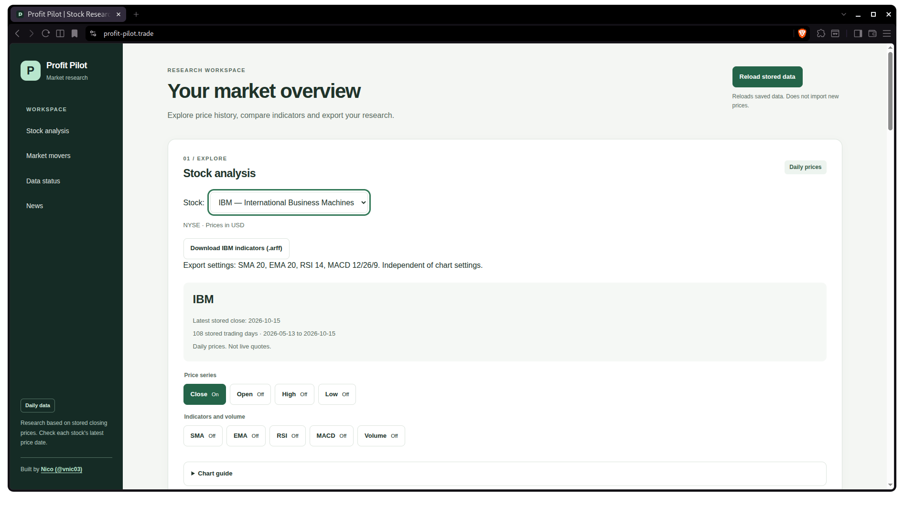
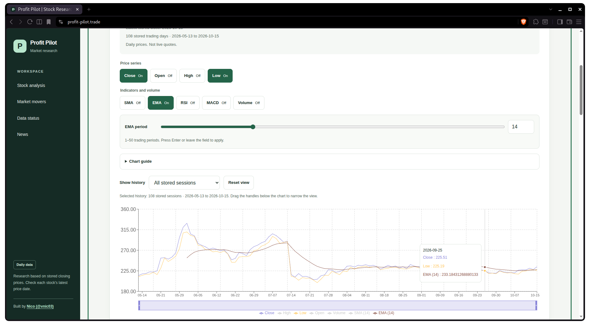
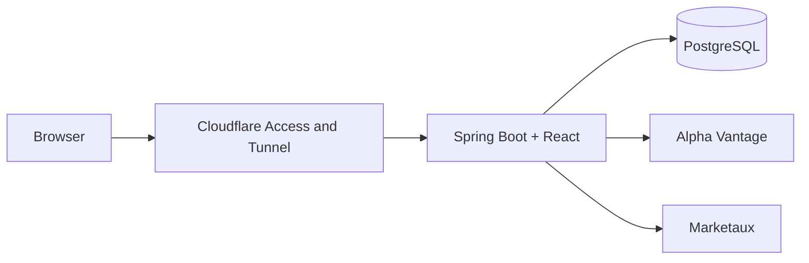
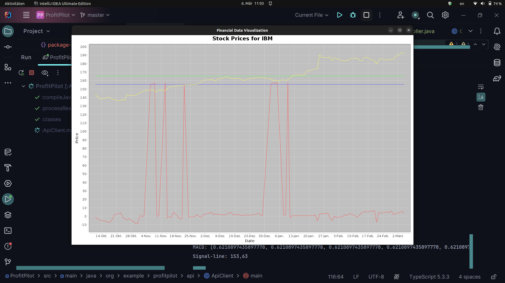

# Profit Pilot

A self-hosted dashboard for exploring stock prices, technical indicators, and company news.

[Website](https://profit-pilot.trade) · [Development guide](doc/development.md) · [Frontend](web/README.md) · [License](LICENSE)

## Why I built it

Profit Pilot started about two years ago as a small Java experiment for plotting stock prices. Since then, I have developed it into a web application with a React frontend, a Spring Boot backend, and a PostgreSQL database.

It is also a project I run myself: the application is hosted on a Raspberry Pi 5, with Cloudflare Access and Tunnel handling access to the website. Working on it has meant dealing with both the charts and the less visible parts—data imports, provider limits, deployment, and recovery when something fails.

## What it does

- Explore daily prices and trading volume for ten US-listed companies.
- Compare SMA, EMA, RSI, and MACD indicators against stored price history.
- See price movements across the tracked companies and read related news.
- Export calculated indicators as ARFF files for analysis in tools such as Weka.
- Inspect data freshness, import results, and remaining API request budgets.

The tracked companies are Apple, Alphabet, Amazon, IBM, JPMorgan Chase, Johnson & Johnson, Coca-Cola, Microsoft, NVIDIA, and ExxonMobil.

Prices are shown in USD. This is a research tool using daily data, not a live trading platform.

## Screenshots





<details>
<summary>News</summary>


</details>

## Try it

The hosted application is available at [profit-pilot.trade](https://profit-pilot.trade).

Access is invitation-only. Contact me through [my GitHub profile](https://github.com/vnic03) if you would like to try it. Approved users sign in with an email code through Cloudflare Access.

To run your own instance, follow the [development guide](doc/development.md).

## How it works

Alpha Vantage supplies daily stock prices, which the backend stores in PostgreSQL. Charts and indicators use these stored prices, so exploring the dashboard does not trigger new price-provider requests. Company news comes from Marketaux.

The optional import schedule checks for updates during the day in New York. The application treats the previous trading day's prices as due from 06:00 New York time; this is an application rule, not a publication guarantee from Alpha Vantage.

Request budgets and import results are stored in the database. This lets the application retain its request accounting and latest completed import report after a restart.



The production build packages the frontend inside the Spring Boot JAR. A systemd service runs it on the Pi.

## Technology

| Area | Tools |
| --- | --- |
| Backend | Java 21, Spring Boot, Spring JDBC, Spring Security |
| Frontend | React, TypeScript, Vite, Recharts, Sass |
| Storage | PostgreSQL |
| Tests | JUnit, Vitest, React Testing Library |
| Hosting | Raspberry Pi 5, systemd, Cloudflare Access and Tunnel |

## Working on the project

The [development guide](doc/development.md) covers database setup, local configuration, startup, testing, and Pi deployment.

The [frontend README](web/README.md) explains the UI source layout and frontend-specific development tools.

```text
web/                                        React frontend
src/main/java/io/github/vnic03/profitpilot/ Backend
src/main/resources/db/                      SQL setup and updates
src/test/java/                              Backend tests
scripts/                                    Build, deployment, and status checks
doc/                                        Setup and operation
assets/                                     Screenshots and project history
```

The test suite covers indicator calculations, import behavior, request budgets, API responses, and frontend loading states. PostgreSQL integration tests run separately against a dedicated test database.

## Current limitations

- Historical coverage varies between stocks. The import freshness check uses the latest stored date; it does not guarantee a gap-free history.
- Update timing depends on the import schedule, provider availability, and request limits.
- Price-movement comparisons cover the ten tracked companies, not the entire market.
- ARFF exports use fixed indicator settings rather than the current chart settings.
- Database setup is manual. The hosted instance runs on a single Raspberry Pi.

## Where it started

The first version was a Java charting experiment. I have kept a screenshot because it shows the starting point of the project.

<details>
<summary>View the original Java prototype</summary>



</details>

## License

The project code is available under the [MIT License](LICENSE).

Built by [Nico (@vnic03)](https://github.com/vnic03).
